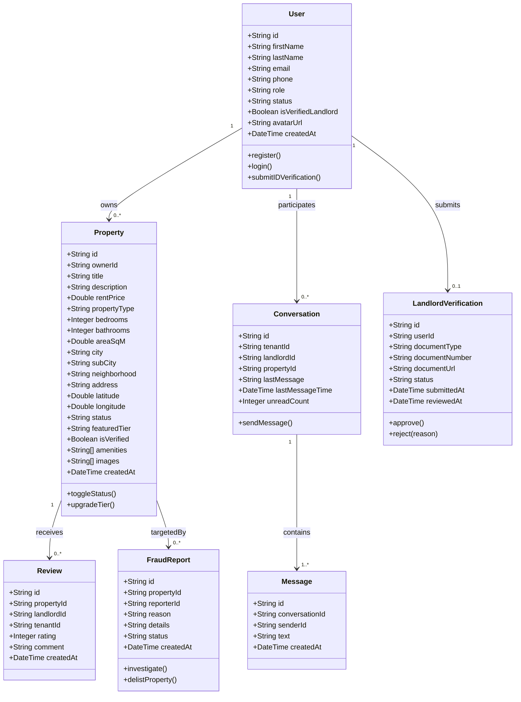
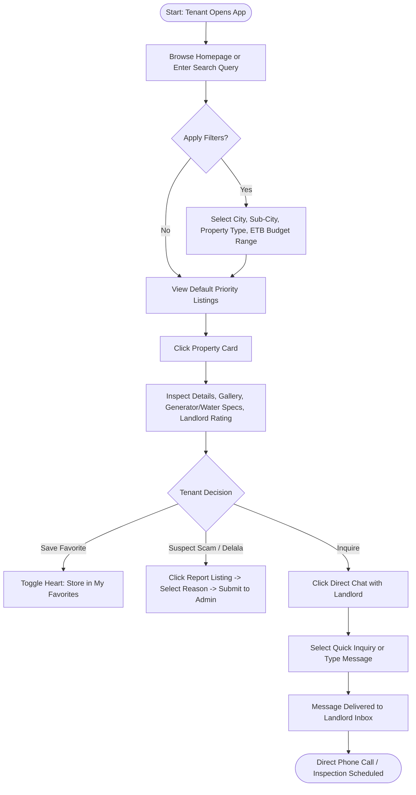
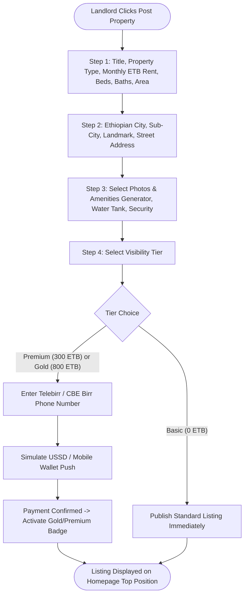
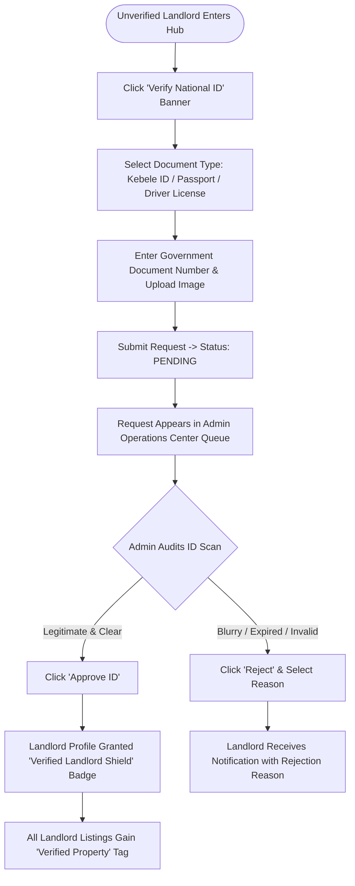
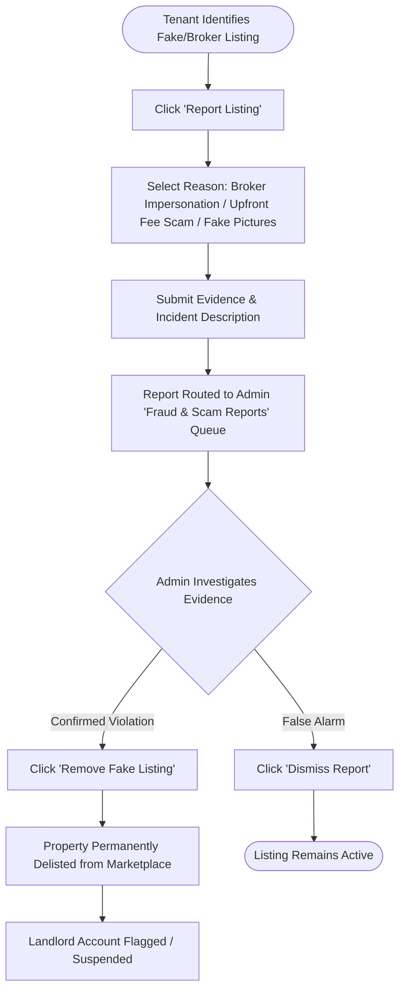
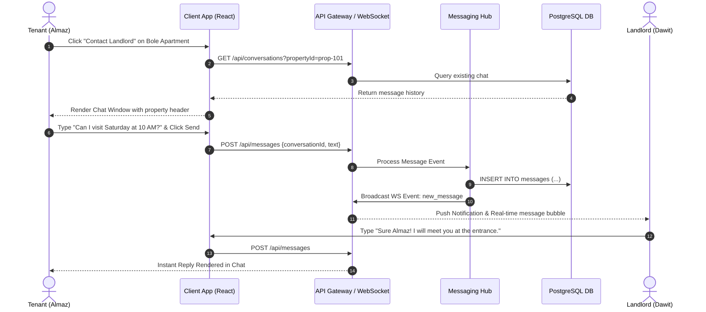
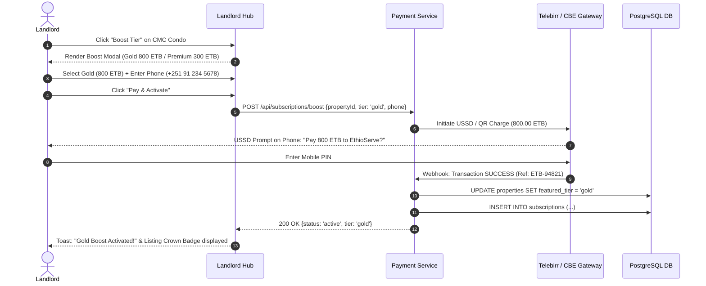

# EthioServe Rent - Low-Level Design (LLD) Specification
**Document Version:** 1.0.0  
**Project:** EthioServe Rental & Landlord Platform  
**Developer & Author:** Mequannent Worku  
**Support Hotline:** 0919798913  
**Target Market:** Ethiopia (Addis Ababa, Adama, Hawassa, Bahir Dar, Dire Dawa)  
**Date:** October 2026  

---

## Table of Contents
1. [Executive Summary & Vision](#1-executive-summary--vision)
2. [System Architecture & Tech Stack](#2-system-architecture--tech-stack)
3. [Use Case & User Role Diagrams](#3-use-case--user-role-diagrams)
4. [Class Diagram & Data Modeling](#4-class-diagram--data-modeling)
5. [Database Entity-Relationship (ER) Schema](#5-database-entity-relationship-er-schema)
6. [Component & Subsystem Design](#6-component--subsystem-design)
7. [Activity Diagrams](#7-activity-diagrams)
   - 7.1 Tenant Property Search & Direct Inquiry Workflow
   - 7.2 Landlord Property Onboarding & Telebirr Boost Workflow
   - 7.3 Landlord Identity Verification & Admin Approval
   - 7.4 Fraud / Broker (Delala) Detection & Triage Workflow
8. [Sequence Diagrams](#8-sequence-diagrams)
   - 8.1 Real-Time Direct Messaging
   - 8.2 Telebirr / CBE Birr Featured Boost Activation
9. [RESTful API Specifications & Endpoints](#9-restful-api-specifications--endpoints)
10. [Fraud Detection & Safety Engine Heuristics](#10-fraud-detection--safety-engine-heuristics)
11. [Localization & Ethiopian Payment Integrations](#11-localization--ethiopian-payment-integrations)
12. [Future Upgrade Roadmap (Phases 2 - 4)](#12-future-upgrade-roadmap-phases-2---4)

---

## 1. Executive Summary & Vision

### 1.1 Problem Statement
In Ethiopia, house seekers and landlords traditionally depend on informal middle brokers (*delalas*). This legacy process suffers from:
- **Exorbitant, non-standardized broker commission fees** (often half or a full month's rent demanded from both tenant and landlord).
- **Advance inspection scams** where fraudulent brokers collect upfront "viewing fees" before disappearing.
- **Counterfeit & duplicate listings**, stolen property pictures, and outdated vacancies.
- **Lack of direct communication channels** between genuine property owners and tenants.

### 1.2 Solution
**EthioServe Rent** is a decentralized, broker-free platform where:
- Genuine Ethiopian landlords register with verified government credentials (National ID / Fayda, Kebele Resident ID, Passport, or Driver's License).
- House seekers search, filter, inspect, and negotiate directly with landlords without middleman fees.
- Listings feature transparent pricing in Ethiopian Birr (ETB), verified utility capabilities (standby 3-phase generators, reserve water tanks), and location landmarks.
- Automated fraud algorithms detect duplicate images, suspicious price-to-subcity ratios, and reported fake brokers.

---

## 2. System Architecture & Tech Stack

```
+-------------------------------------------------------------------------+
|                           CLIENT LAYER                                  |
|   +--------------------------+          +---------------------------+   |
|   |  Web SPA (React 19 /     |          |  Mobile App (Flutter)     |   |
|   |  Vite / Tailwind CSS v4) |          |  (iOS / Android)          |   |
|   +--------------------------+          +---------------------------+   |
+------------------------------------+------------------------------------+
                                     |  HTTPS / REST / WebSocket (WSS)
+------------------------------------v------------------------------------+
|                         API GATEWAY & SECURITY                          |
|  - JWT / Firebase Auth Token Interceptor                                |
|  - Rate Limiting & DDOS Shield                                          |
|  - Ethiopian Mobile Phone Validator (+251 / 09 / 07)                    |
|  - Anti-Broker Heuristics Engine                                        |
+------------------------------------+------------------------------------+
                                     |
+------------------------------------v------------------------------------+
|                         APPLICATION SERVICES                            |
|  +------------------------+  +-------------------+  +-----------------+ |
|  | Auth & User Service    |  | Property Service  |  | Messaging Hub   | |
|  +------------------------+  +-------------------+  +-----------------+ |
|  +------------------------+  +-------------------+  +-----------------+ |
|  | Identity Verif Service |  | Telebirr / CBE    |  | Fraud & Audit   | |
|  | (OCR & Manual Review)  |  | Payment Webhook   |  | Incident Engine | |
|  +------------------------+  +-------------------+  +-----------------+ |
+------------------------------------+------------------------------------+
                                     |
+------------------------------------v------------------------------------+
|                       PERSISTENCE & STORAGE                             |
|  +------------------------------------+  +----------------------------+ |
|  | PostgreSQL (Relational Master)     |  | Cloudinary / S3 Bucket     | |
|  | (Users, Properties, Reviews, etc.) |  | (Encrypted ID scans, pics) | |
|  +------------------------------------+  +----------------------------+ |
|  +--------------------------------------------------------------------+ |
|  | Redis Cache (Active Sessions, Rate limits, Real-time message queue)| |
|  +--------------------------------------------------------------------+ |
+-------------------------------------------------------------------------+
```

---

## 3. Use Case & User Role Diagrams

### 3.1 Actors
1. **Tenant (House Seeker):** Searches properties, applies multi-criteria filters, saves favorites, communicates directly with landlords, reviews landlords, reports scam/broker violations.
2. **Landlord (Property Owner):** Submits government identity credentials, creates property listings, uploads unit media, responds to tenant inquiries, toggles vacancy status, boosts visibility via Telebirr/CBE.
3. **Admin (EthioServe Trust & Safety):** Audits landlord verification documents, resolves tenant scam reports, de-lists fraudulent properties, moderates user accounts, tracks ETB monetization.

### 3.2 Use Case Diagram (Mermaid)

```mermaid
graph TD
    Tenant((Tenant))
    Landlord((Landlord))
    Admin((Platform Admin))

    subgraph Auth Module
        UC1[Register with Email/Phone]
        UC2[Login & OTP Verification]
        UC3[Switch Persona / Role]
    end

    subgraph Property & Discovery
        UC4[Search & Filter by City/Sub-City/ETB]
        UC5[View Property Gallery & Specifications]
        UC6[Save to Favorites]
        UC7[Post New Rental Property]
        UC8[Manage Vacancy: Available / Occupied]
        UC9[Boost Listing: Premium / Gold via Telebirr]
    end

    subgraph Communication & Trust
        UC10[Direct Real-Time Chat]
        UC11[Call Landlord via +251]
        UC12[Submit Landlord ID Verification]
        UC13[Submit Fraud / Delala Report]
        UC14[Rate & Review Landlord]
    end

    subgraph Governance & Admin
        UC15[Approve / Reject Landlord IDs]
        UC16[Triage Fraud Reports & Delist Fake Houses]
        UC17[Suspend / Reactivate User Accounts]
        UC18[Monitor Platform ETB Revenue]
    end

    Tenant --> UC1
    Tenant --> UC2
    Tenant --> UC4
    Tenant --> UC5
    Tenant --> UC6
    Tenant --> UC10
    Tenant --> UC11
    Tenant --> UC13
    Tenant --> UC14

    Landlord --> UC1
    Landlord --> UC2
    Landlord --> UC7
    Landlord --> UC8
    Landlord --> UC9
    Landlord --> UC10
    Landlord --> UC12

    Admin --> UC15
    Admin --> UC16
    Admin --> UC17
    Admin --> UC18
```



---

## 4. Class Diagram & Data Modeling



---

## 5. Database Entity-Relationship (ER) Schema

### 5.1 Tables Definition (PostgreSQL)

```sql
-- 1. Users Table
CREATE TABLE users (
    id UUID PRIMARY KEY DEFAULT gen_random_uuid(),
    first_name VARCHAR(60) NOT NULL,
    last_name VARCHAR(60) NOT NULL,
    email VARCHAR(120) UNIQUE NOT NULL,
    phone VARCHAR(20) UNIQUE NOT NULL,
    password_hash VARCHAR(255) NOT NULL,
    role VARCHAR(20) CHECK (role IN ('tenant', 'landlord', 'admin')) DEFAULT 'tenant',
    status VARCHAR(20) CHECK (status IN ('active', 'suspended')) DEFAULT 'active',
    is_verified_landlord BOOLEAN DEFAULT FALSE,
    id_document_type VARCHAR(50),
    id_document_number VARCHAR(80),
    avatar_url TEXT,
    created_at TIMESTAMP WITH TIME ZONE DEFAULT NOW()
);

-- 2. Properties Table
CREATE TABLE properties (
    id UUID PRIMARY KEY DEFAULT gen_random_uuid(),
    owner_id UUID NOT NULL REFERENCES users(id) ON DELETE CASCADE,
    title VARCHAR(200) NOT NULL,
    description TEXT NOT NULL,
    rent_price NUMERIC(12, 2) NOT NULL, -- in ETB
    property_type VARCHAR(40) CHECK (property_type IN ('Apartment', 'Villa', 'Condominium', 'Studio', 'Commercial Building', 'Office', 'Shop')) NOT NULL,
    bedrooms INT NOT NULL DEFAULT 1,
    bathrooms INT NOT NULL DEFAULT 1,
    area_sqm NUMERIC(8, 2),
    city VARCHAR(60) NOT NULL,
    sub_city VARCHAR(60) NOT NULL,
    neighborhood VARCHAR(120) NOT NULL,
    address TEXT NOT NULL,
    latitude DOUBLE PRECISION,
    longitude DOUBLE PRECISION,
    status VARCHAR(20) CHECK (status IN ('available', 'occupied')) DEFAULT 'available',
    featured_tier VARCHAR(20) CHECK (featured_tier IN ('basic', 'premium', 'gold')) DEFAULT 'basic',
    is_verified BOOLEAN DEFAULT FALSE,
    amenities JSONB DEFAULT '[]'::jsonb,
    images JSONB DEFAULT '[]'::jsonb,
    views_count INT DEFAULT 0,
    created_at TIMESTAMP WITH TIME ZONE DEFAULT NOW()
);

-- 3. Property Images Table (Normalized)
CREATE TABLE property_images (
    id UUID PRIMARY KEY DEFAULT gen_random_uuid(),
    property_id UUID NOT NULL REFERENCES properties(id) ON DELETE CASCADE,
    image_url TEXT NOT NULL,
    image_hash VARCHAR(64), -- SHA-256 for duplicate fraud detection
    sort_order INT DEFAULT 0,
    created_at TIMESTAMP WITH TIME ZONE DEFAULT NOW()
);

-- 4. Conversations Table
CREATE TABLE conversations (
    id UUID PRIMARY KEY DEFAULT gen_random_uuid(),
    tenant_id UUID NOT NULL REFERENCES users(id) ON DELETE CASCADE,
    landlord_id UUID NOT NULL REFERENCES users(id) ON DELETE CASCADE,
    property_id UUID NOT NULL REFERENCES properties(id) ON DELETE CASCADE,
    last_message TEXT,
    last_message_time TIMESTAMP WITH TIME ZONE DEFAULT NOW(),
    unread_count_tenant INT DEFAULT 0,
    unread_count_landlord INT DEFAULT 0,
    UNIQUE(tenant_id, landlord_id, property_id)
);

-- 5. Messages Table
CREATE TABLE messages (
    id UUID PRIMARY KEY DEFAULT gen_random_uuid(),
    conversation_id UUID NOT NULL REFERENCES conversations(id) ON DELETE CASCADE,
    sender_id UUID NOT NULL REFERENCES users(id) ON DELETE CASCADE,
    message TEXT NOT NULL,
    created_at TIMESTAMP WITH TIME ZONE DEFAULT NOW()
);

-- 6. Favorites Table
CREATE TABLE favorites (
    id UUID PRIMARY KEY DEFAULT gen_random_uuid(),
    user_id UUID NOT NULL REFERENCES users(id) ON DELETE CASCADE,
    property_id UUID NOT NULL REFERENCES properties(id) ON DELETE CASCADE,
    created_at TIMESTAMP WITH TIME ZONE DEFAULT NOW(),
    UNIQUE(user_id, property_id)
);

-- 7. Landlord Verifications Table
CREATE TABLE verifications (
    id UUID PRIMARY KEY DEFAULT gen_random_uuid(),
    user_id UUID NOT NULL REFERENCES users(id) ON DELETE CASCADE,
    document_type VARCHAR(60) NOT NULL,
    document_number VARCHAR(100) NOT NULL,
    document_url TEXT NOT NULL,
    selfie_url TEXT,
    status VARCHAR(20) CHECK (status IN ('pending', 'approved', 'rejected')) DEFAULT 'pending',
    rejection_reason TEXT,
    submitted_at TIMESTAMP WITH TIME ZONE DEFAULT NOW(),
    reviewed_at TIMESTAMP WITH TIME ZONE
);

-- 8. Fraud Reports Table
CREATE TABLE fraud_reports (
    id UUID PRIMARY KEY DEFAULT gen_random_uuid(),
    property_id UUID NOT NULL REFERENCES properties(id) ON DELETE CASCADE,
    reporter_id UUID NOT NULL REFERENCES users(id) ON DELETE CASCADE,
    reason VARCHAR(80) NOT NULL,
    details TEXT NOT NULL,
    status VARCHAR(20) CHECK (status IN ('pending', 'investigating', 'resolved', 'dismissed')) DEFAULT 'pending',
    created_at TIMESTAMP WITH TIME ZONE DEFAULT NOW()
);

-- 9. Reviews Table
CREATE TABLE reviews (
    id UUID PRIMARY KEY DEFAULT gen_random_uuid(),
    property_id UUID NOT NULL REFERENCES properties(id) ON DELETE CASCADE,
    landlord_id UUID NOT NULL REFERENCES users(id) ON DELETE CASCADE,
    tenant_id UUID NOT NULL REFERENCES users(id) ON DELETE CASCADE,
    rating SMALLINT CHECK (rating BETWEEN 1 AND 5) NOT NULL,
    comment TEXT NOT NULL,
    created_at TIMESTAMP WITH TIME ZONE DEFAULT NOW()
);

-- 10. Subscriptions & Payments Table
CREATE TABLE subscriptions (
    id UUID PRIMARY KEY DEFAULT gen_random_uuid(),
    property_id UUID NOT NULL REFERENCES properties(id) ON DELETE CASCADE,
    landlord_id UUID NOT NULL REFERENCES users(id) ON DELETE CASCADE,
    tier VARCHAR(20) CHECK (tier IN ('basic', 'premium', 'gold')) NOT NULL,
    amount NUMERIC(10, 2) NOT NULL, -- 0, 300, or 800 ETB
    payment_method VARCHAR(30) CHECK (payment_method IN ('telebirr', 'cbe_birr', 'chapa')) NOT NULL,
    payment_reference VARCHAR(120),
    starts_at TIMESTAMP WITH TIME ZONE DEFAULT NOW(),
    expires_at TIMESTAMP WITH TIME ZONE NOT NULL
);
```

---

## 6. Component & Subsystem Design

| Module Component | Location | Responsibility |
|---|---|---|
| `Navbar` | `src/components/Navbar.tsx` | Global navigation, Ethiopian persona switcher, notification popover, language selector (EN/Amharic), quick action buttons. |
| `HeroSection` | `src/components/HeroSection.tsx` | Hero banner with trust guarantees, search text input, Ethiopian city/sub-city selectors, bedroom & ETB budget controls. |
| `PropertyCard` | `src/components/PropertyCard.tsx` | Renders individual listing with Gold/Premium badges, verified shield check, ETB rent pricing, amenity badges, and quick contact action. |
| `PropertyDetailModal` | `src/components/PropertyDetailModal.tsx` | Detailed modal view with multi-image gallery, unit specifications, landlord profile & phone link, tenant reviews list, review submission form, and anti-delala fraud trigger. |
| `PostPropertyModal` | `src/components/PostPropertyModal.tsx` | 4-step wizard: Basic specs, Location & landmarks, Photo uploads & amenities, Visibility boost tier selection. |
| `MessagingModal` | `src/components/MessagingModal.tsx` | Direct chat window with active property header context, conversation history, quick inquiry suggestions, block/unblock controls. |
| `LandlordDashboard` | `src/components/LandlordDashboard.tsx` | Landlord portfolio management: vacancy status toggle, boost trigger, ID verification submission banner, delete confirmation modal. |
| `AdminDashboard` | `src/components/AdminDashboard.tsx` | Operational KPIs, landlord ID approval/rejection queue, scam report investigation, user management, and revenue analytics. |
| `VerificationModal` | `src/components/VerificationModal.tsx` | Modal for submitting Ethiopian Kebele ID, Passport, or Driver's License. |
| `UpgradeTierModal` | `src/components/UpgradeTierModal.tsx` | Boost package checkout simulating Telebirr, CBE Birr, and Chapa USSD/SMS pushes. |
| `FraudReportModal` | `src/components/FraudReportModal.tsx` | Tenant reporting modal for broker impersonation, fake photos, or advance inspection fee demands. |
| `rules.ts` | `src/utils/rules.ts` | Decoupled pure business logic: multi-criteria filtering, tier-based sorting, ETB currency formatter, fraud heuristics, and review rating math. |

---

## 7. Activity Diagrams

### 7.1 Tenant Property Search & Direct Inquiry Workflow


### 7.2 Landlord Property Onboarding & Telebirr Boost Workflow


### 7.3 Landlord Identity Verification & Admin Approval


### 7.4 Fraud / Broker (Delala) Detection & Triage Workflow


---

## 8. Sequence Diagrams

### 8.1 Real-Time Direct Messaging


### 8.2 Telebirr / CBE Birr Featured Boost Activation


---

## 9. RESTful API Specifications & Endpoints

### 9.1 Authentication & Profile
- `POST /api/auth/register`
  - **Body:** `{ firstName, lastName, email, phone, password, role }`
  - **Response:** `{ token, user: { id, firstName, email, role, status } }`
- `POST /api/auth/login`
  - **Body:** `{ emailOrPhone, password }`
  - **Response:** `{ token, user }`
- `POST /api/auth/verify-otp`
  - **Body:** `{ phone, otpCode }`
  - **Response:** `{ verified: true }`

### 9.2 Property Management & Search
- `GET /api/properties`
  - Returns paginated active properties.
- `GET /api/properties/search`
  - **Query Params:** `city`, `subCity`, `minPrice`, `maxPrice`, `bedrooms`, `propertyType`, `verifiedOnly`, `sortBy`
  - **Example:** `/api/properties/search?city=Addis%20Ababa&subCity=Bole&minPrice=20000&maxPrice=70000&bedrooms=2`
- `GET /api/properties/:id`
  - Returns property details, image array, amenities, verified status, and landlord profile.
- `POST /api/properties`
  - **Headers:** `Authorization: Bearer <token>`
  - **Body:** `{ title, description, rentPrice, propertyType, bedrooms, bathrooms, areaSqM, city, subCity, neighborhood, address, amenities, images, featuredTier }`
- `PUT /api/properties/:id`
  - Allows landlord to update rent price, vacancy status (`available` / `occupied`), or description.
- `DELETE /api/properties/:id`
  - Deletes or archives the listing.

### 9.3 Direct Messaging
- `GET /api/conversations`
  - Returns conversations list for current user.
- `POST /api/messages`
  - **Body:** `{ conversationId, text }`
  - **Response:** Message object with timestamp.
- `POST /api/users/block`
  - **Body:** `{ targetUserId }`

### 9.4 Verification & Trust
- `POST /api/verifications/submit`
  - **Body:** `{ documentType, documentNumber, documentUrl, selfieUrl }`
- `GET /api/admin/verifications`
  - **Headers:** Admin JWT
  - Returns queue of pending landlord verifications.
- `POST /api/admin/verifications/:id/approve`
- `POST /api/admin/verifications/:id/reject`
  - **Body:** `{ reason }`

### 9.5 Anti-Fraud Reports
- `POST /api/reports`
  - **Body:** `{ propertyId, reason, details }`
- `GET /api/admin/reports`
  - Returns tenant incident reports.
- `POST /api/admin/reports/:id/resolve`
  - **Body:** `{ action: 'remove_property' | 'dismiss' }`

### 9.6 Reviews & Ratings
- `POST /api/reviews`
  - **Body:** `{ propertyId, landlordId, rating, comment }`
- `GET /api/reviews?landlordId=:id`

---

## 10. Fraud Detection & Safety Engine Heuristics

The platform incorporates an automated anti-scam module (`detectSuspiciousPrice` and `detectDuplicateImages`):

1. **Duplicate Photo Fingerprinting:**
   - On photo upload, a perceptual SHA-256 hash is computed.
   - If identical images are submitted across different landlord accounts, the system raises an internal anomaly flag: `"Cross-Owner Photo Reuse Alert"`.
2. **Sub-City Price Anomaly Detection:**
   - If a landlord lists a property in a high-demand sub-city (e.g. Bole, Old Airport) at `< 35%` of the median historical price for that property type, it triggers: `"Suspiciously Low Rent Alert - Possible Advance Fee Scam"`.
3. **Tenant Anti-Delala Enforcement:**
   - Every property detail view explicitly presents the **EthioServe Anti-Broker Guarantee**, advising tenants never to pay viewing fees before signing a verified lease.
   - One-click incident reporting routes complaints directly to the Admin triage desk.

---

## 11. Localization & Ethiopian Payment Integrations

- **Currency:** Formatted exclusively in **Ethiopian Birr (ETB)** with comma separators (e.g., `65,000 ETB / month`).
- **Language Support:** Dynamic bilingual support for English and **አማርኛ (Amharic)** with synchronized translation dictionaries (`src/utils/i18n.ts`).
- **Payment Providers:**
  - **Telebirr (Ethio Telecom):** USSD push and QR code API integration for instant subscription boost fees.
  - **CBE Birr (Commercial Bank of Ethiopia):** Direct merchant checkout.
  - **Chapa Financial Technologies:** Credit/debit card and digital wallet aggregator.
- **Direct Support Hotline:** **`0919798913`** embedded in footer and administrative communication channels.

---

## 12. Future Upgrade Roadmap (Phases 2 - 4)

### Phase 2: Enhanced Geospatial & Interactive Tours
- **Interactive OpenStreetMap / Google Maps View:** Interactive pins colored by featured tier and cluster markers by sub-city.
- **360° Virtual Property Tours:** WebGL panorama viewer allowing tenants to walk through rooms virtually before physically traveling across Addis Ababa traffic.
- **AI Recommendation Engine:** Personalized recommendation feed based on tenant search history and price sensitivity.

### Phase 3: Digital Lease Agreements & In-App Rent Escrow
- **Digital Rental Contracts (ውል):** Standardized, legally compliant Ethiopian tenancy contract templates with digital signatures.
- **Direct Rent Escrow via Telebirr:** Tenants pay monthly rent through the platform; funds are released to landlord upon verification of utility and key handover.
- **Utility & Maintenance Request Tracking:** Tenant ticket submission for plumbing, backup generator fuel contributions, or water reservoir maintenance.

### Phase 4: Expansion & Short-Term Stays
- **Commercial & Office Marketplace:** Dedicated commercial portal for business centers, retail malls, and shared coworking spaces in Kazanchis and Bole.
- **Guesthouse & Short-Term Stays (Ethiopian Airbnb Alternative):** Daily and weekly rentals for diaspora visitors and domestic tourists in Hawassa, Bishoftu, and Bahir Dar.

---

**EthioServe Rent**  
*Developed by Mequannent Worku*  
*Direct Support Hotline: 0919798913*  
*Addis Ababa, Ethiopia*
